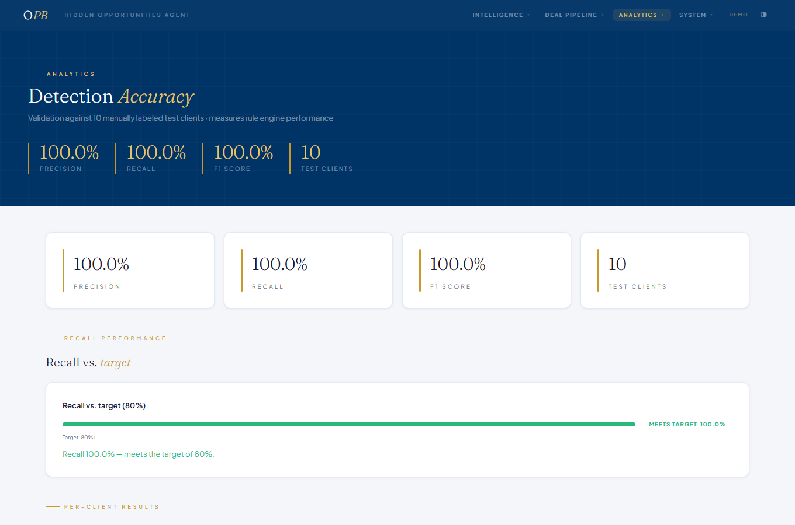
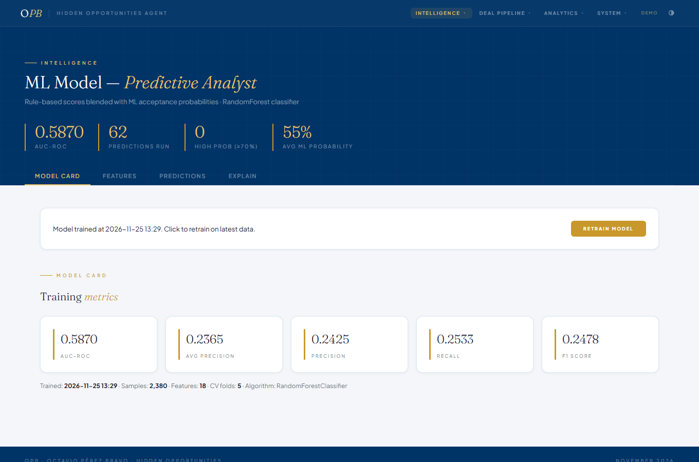
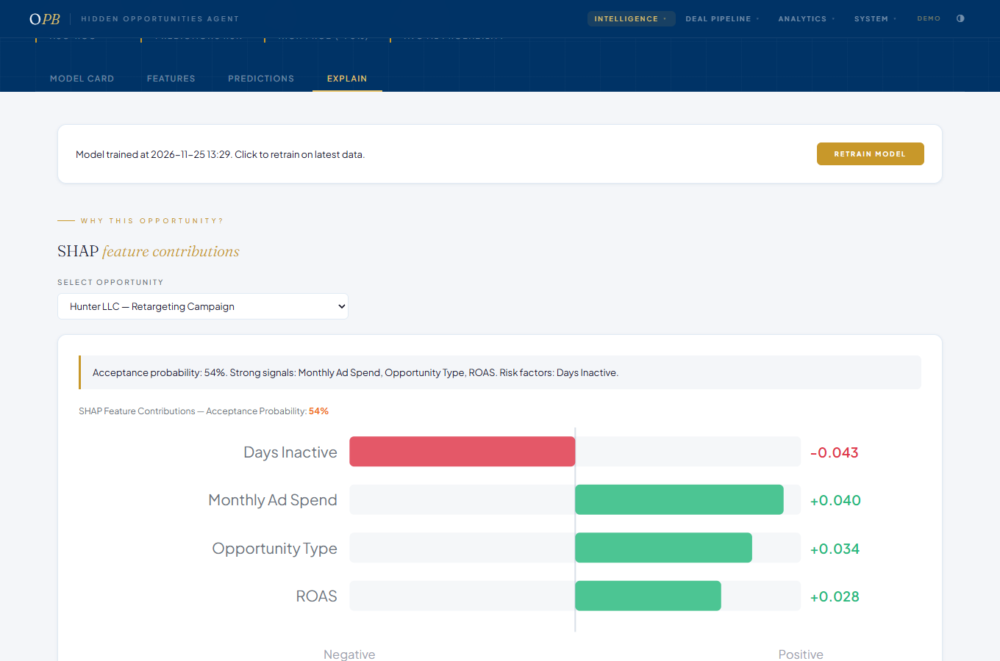
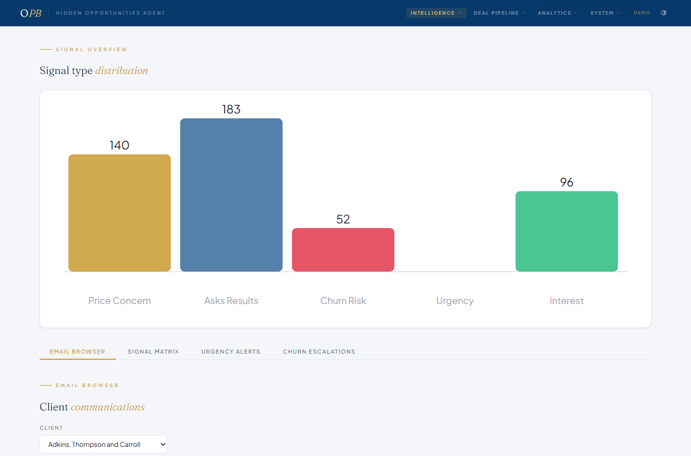

# Applied AI

Where the system uses AI, where it deliberately does not, and what the measurements do and do not show.

---

## 1. Map of techniques

| Stage | Technique | Model | Notes |
|---|---|---|---|
| Detection | Seven threshold rules | none | Explainable; each result carries its signals and a rationale |
| Acceptance probability | Random forest | scikit-learn | Blended 55/45 with the rule score; affects ordering |
| Explanation | SHAP `TreeExplainer` | — | Top four features per prediction |
| Learning from replies | Fixed score deltas and acceptance-rate tiers | none | Immediate, no training needed |
| Text signals | Keyword lexicons | none | An LLM path exists but the API and daily job do not use it |
| Proposal text | Template + one personalised paragraph | LLM optional | Template paragraph when no key is set |
| Negotiation intent | Keyword patterns with negation handling | LLM optional (Anthropic) | Falls back to keywords |
| Negotiation replies | Fixed templates; discounts set by code | LLM optional, only when `DEMO_MODE=false` | The model never chooses the price |
| Seasonality | Month multipliers | none | |

## 2. Detection rules

| Opportunity | Fires when | Price |
|---|---|---|
| Reactivation | inactive ≥ 45 days | $150 |
| Email automation | open rate < 15% | $300 |
| Conversion rate audit | CTR > 5% and conversion < 1% | $250 |
| Landing page optimisation | CTR > 4%, bounce > 70%, pages/session < 2 | $350 |
| Retargeting campaign | monthly ad spend > $2,000 and ROAS < 2.5 | $400 |
| Ad budget expansion | ROAS > 4 and monthly ad spend < $800 | $200 |
| SEO content | organic traffic > 1,000, < 20 keywords, conversion < 1.5% | $500 |

The Accuracy page evaluates these rules against 10 hand-labelled clients and shows 100% precision and
recall.

**Read it as a regression check, not as accuracy.** The cases were written alongside the thresholds.
It says nothing about whether real clients would buy.

## 3. Acceptance model

**Features (18):** ad, site, email, SEO and activity metrics; five text-signal flags; account age,
industry and opportunity type.

**Training data**, in `src/ml/dataset.py`:

1. Real outcomes from `feedback_log`.
2. The labelled test cases, with "rule expected" treated as "accepted".
3. 300 generated clients, labelled by the rules with added noise.
4. Noisy copies (×3) of sources 1 and 2.

**Measured on the demo database used for the screenshots** (2,380 samples, 5-fold):

| AUC-ROC | Average precision | Precision | Recall | F1 |
|---|---|---|---|---|
| 0.587 | 0.237 | 0.243 | 0.253 | 0.248 |

What this means:

- The model is **barely better than chance** here. It has not demonstrated predictive value.
- Most labels come from the rules, so what it can learn is largely the rules, plus noise.
- Augmented copies are added **before** cross-validation, so copies of a row can fall in both training
  and validation folds. Treat the figures as optimistic.
- A different local database gave AUC 0.72. Results depend on the data and are not comparable between
  runs.

Do not present the probability to a client or sponsor as a forecast until it is trained and validated on
real outcomes.

### Explanations

SHAP shows what moved *the model's* output. With a weak model, a clear explanation of a prediction is
not evidence that the prediction is right.

## 4. Text signals

Keyword lexicons mark price concern, requests for results, churn risk, urgency and interest, and give a
simple word-count sentiment. The flags feed the model and the churn scan.

Limits: English only; no negation handling ("not urgent" still matches); substring matching; on the
screenshot data urgency never fires.

## 5. LLM use and grounding

Only the personalised paragraph, intent classification and (outside demo mode) negotiation replies can
use a model.

| Safeguard | State |
|---|---|
| Price and discount are computed by code | In place |
| A person approves proposals in tiers A and B | In place |
| Provider failure falls back to templates or keywords | In place, tested with fakes |
| LLM paragraph is checked against the client's real figures | **Not in place** |
| Client data is anonymised before the call | **Not in place**: the proposal prompt includes the client name and metrics |
| Negation: "can't accept" is not an acceptance | In place in the keyword classifier |

The negotiation prompt asks for Spanish while the templates and the rest of the product are in English.

No LLM output quality has been evaluated. The tests replace the providers with fakes: they prove the
wiring, not the writing.

## 6. What would make the AI claims real

1. Collect outcomes from real proposals and train on those only.
2. Split by client before augmentation; report a held-out set and a calibration curve.
3. Compare against the baseline of rule score alone. Keep the model only if it wins.
4. Label a set of real emails and measure the signal extractor per flag.
5. Verify every number in an LLM paragraph against the context, and refuse the paragraph otherwise.
