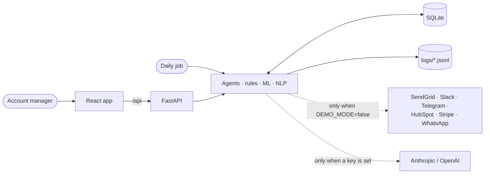
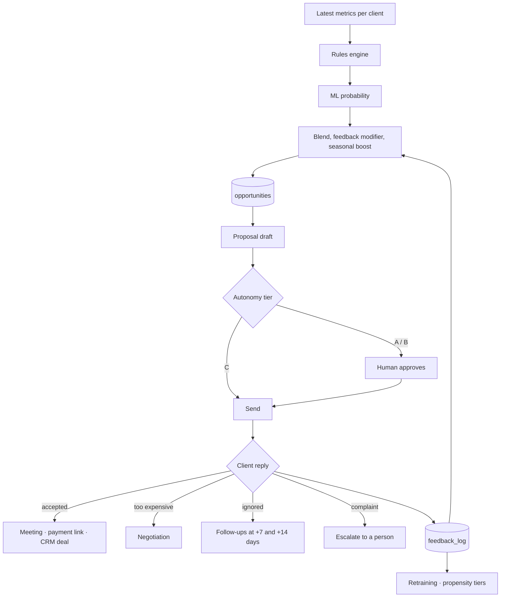
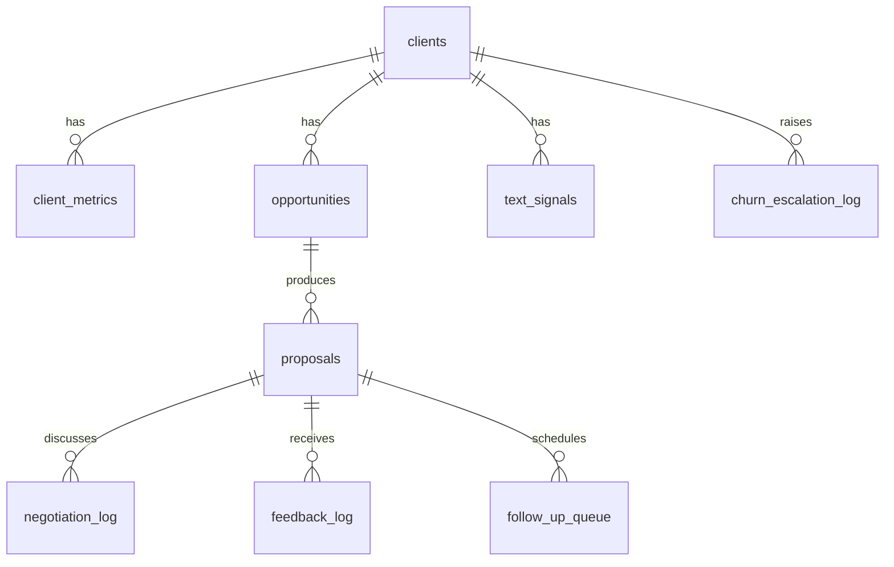

# Architecture

Hidden Opportunities Agent finds upsell and cross-sell opportunities in a marketing agency's client
portfolio, drafts a proposal for each, sends it through an approval tier, and learns from the reply.

---

## 1. System context

In the demo, every data source reads the same SQLite database, filled with synthetic data. The
connectors for Google Analytics, Meta Ads, email marketing and SEO tools are **adapters over that
database**; their production endpoints are documented in each module but not implemented.

## 2. Components

| Path | Responsibility |
|---|---|
| `frontend/` | React 18 + TypeScript. 11 pages, one HTTP client (`services/api.ts`), no state library |
| `backend/main.py`, `backend/routers/` | FastAPI app: 14 routers, 69 operations, error mapping |
| `src/agents/rules.py` | The seven detection rules and suggested prices |
| `src/agents/scorer.py` | Portfolio scoring, blending, caching, persistence |
| `src/agents/proposal_generator.py` | Templates, optional LLM paragraph, Markdown export |
| `src/agents/auto_sender.py`, `email_sender.py` | Autonomy tiers and delivery |
| `src/agents/feedback_loop.py` | Reply intents and their downstream actions |
| `src/agents/negotiator.py`, `payment_link.py` | Price negotiation and checkout link |
| `src/agents/follow_up_engine.py`, `churn_escalation.py` | Re-engagement and retention |
| `src/agents/propensity_ranker.py`, `seasonal_engine.py`, `analytics_engine.py` | Prioritisation and reporting |
| `src/ml/`, `src/nlp/` | Acceptance model, SHAP explanations, text-signal extraction |
| `src/data_sources/`, `src/integrations/` | Inbound adapters; HubSpot and WhatsApp |
| `src/db/schema.py`, `src/jsonl.py` | Schema, migrations, indexes; append-only logs |
| `scripts/` | Seed, train, detect, process text, daily job |
| `src/ui/` | Legacy Streamlit UI. Superseded by `frontend/`, still present |

## 3. The loop, step by step

### Scoring order (`score_all_clients`)

1. One query loads the latest metrics row of every client; one loads clients and propensity.
2. The rules return zero or more opportunities per client, each with a 0–100 score.
3. If a model file exists, `blended = 0.55 × probability × 100 + 0.45 × rule score`.
4. The **feedback modifier** shifts both scores by the sum of the last ten replies for that client and
   opportunity type (accepted +15 … escalated −30, clamped to ±50).
5. The **seasonal multiplier** for the current month is applied, capped at 100.
6. Results are ordered by propensity tier, then by blended score, and cached for five minutes.

The UI displays `score` (rules, modifier, season). The ML probability influences **ordering**, not the
number shown on the card.

## 4. Data model

Also `analytics_snapshots` and `crm_sync_log`. `init_db()` creates every table and index;
`migrate_db()` only adds columns missing from older databases. Foreign keys are enforced and the
database runs in WAL mode.

| Entity | Statuses |
|---|---|
| Proposal | `draft` → `approved` → `sent` → `accepted` · `rejected` · `escalated` · `paid` |
| Opportunity | `detected` → `proposal_generated` → `sent` → `closed` · `rejected` · `escalated` |
| Follow-up | `pending` → `sent` · `cancelled` |

A negotiation has no status column: it is open while no row in its thread carries a terminal intent.

## 5. Autonomy tiers

| Tier | Condition in code (`auto_sender.get_autonomy_tier`) | Effect |
|---|---|---|
| **A** | everything else | Draft only |
| **B** | score ≥ 70 | A person approves before sending |
| **C** | score ≥ 90, price ≤ $200 (reactivation ≤ $150), and repeat client or reactivation | Sent by the auto-send queue |

The intended policy is in [planning/GOVERNANCE.md](../planning/GOVERNANCE.md). The code implements only
part of it; see [KNOWLEDGE_LEARNED.md §7](KNOWLEDGE_LEARNED.md#7-open-findings).

## 6. Outbound boundary

`DEMO_MODE=true` (the default) writes emails, alerts, calendar events, escalations, CRM syncs, WhatsApp
messages and follow-ups to `logs/*.jsonl` instead of calling a provider. Stripe returns a placeholder
link.

**`DEMO_MODE` does not gate the LLM.** The proposal paragraph and negotiation intent classification
call a provider whenever its key is configured. Placeholder values ending in `...` count as unset.

## 7. Security boundaries

| Control | State |
|---|---|
| Secrets | `.env`, git-ignored; placeholders ignored |
| SQL | Parameterised values throughout |
| CORS | `localhost:5173` and `localhost:3000` only |
| Input validation | Pydantic models; `ValueError` becomes 400 or 404 with a message |
| **Authentication / authorisation** | **None.** Anyone who can reach the API can approve, send, train and delete the alert log |
| CI | CodeQL, Dependabot, Claude review on pull requests |

The application is safe to run **locally with synthetic data**. It must not be exposed to a network or
given real client data before authentication exists.

## 8. Deployment

| Mode | How |
|---|---|
| Local (supported) | `uvicorn backend.main:app --port 8000` and `npm run dev` in `frontend/`, or `run.bat` |
| Docker | `Dockerfile` and `docker-compose.yml` **still start the legacy Streamlit UI** and do not run this architecture |
| Scheduled | `python scripts/daily_job.py` (no scheduler is shipped) |
