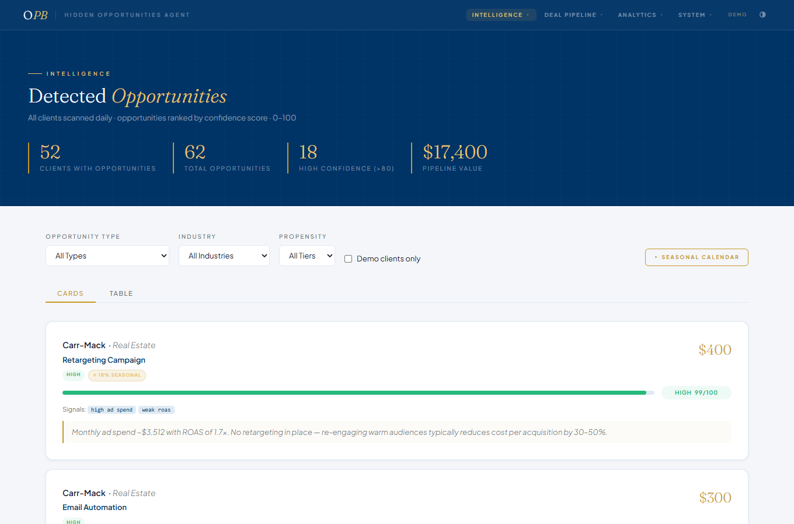
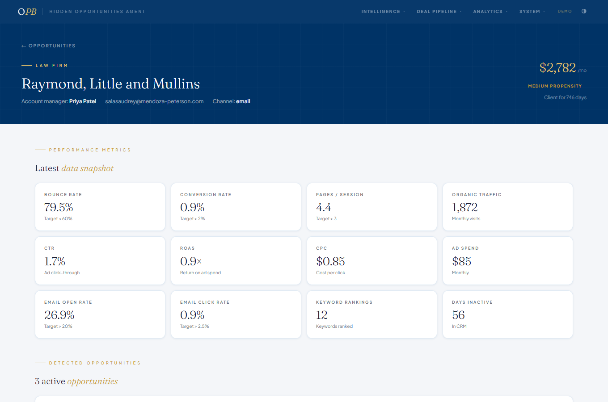
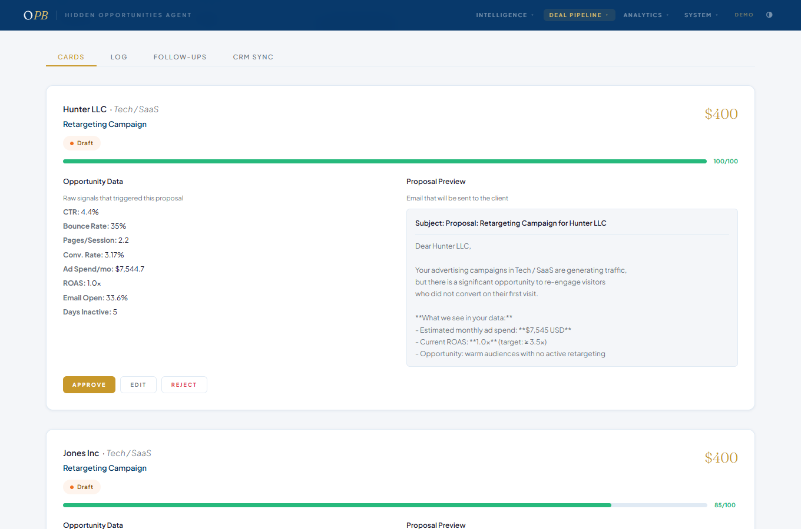
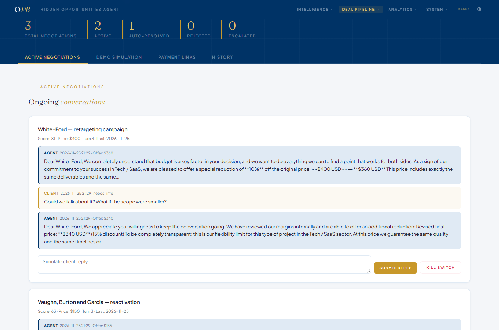
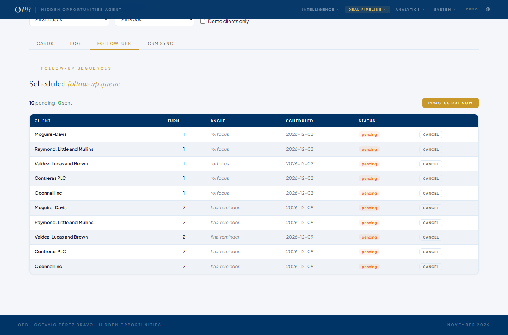
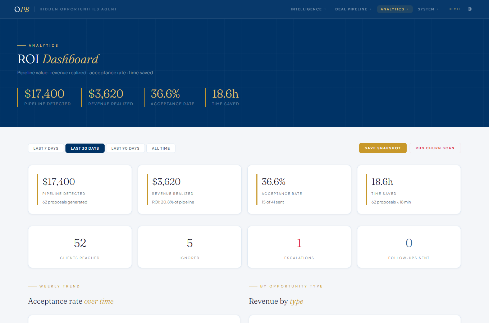

# Business Value

What Hidden Opportunities Agent offers a marketing agency, for whom, and with what limits. For agency
owners, account leads and sponsors.

---

## 1. The problem

An account manager cannot read every client's dashboards every day. The obvious upsells get noticed;
patterns across ads, web, email and inactivity do not. When one is spotted, writing the proposal takes
time, follow-up is irregular, and nobody records why it was accepted or refused.

## 2. What changes

| Stage | By hand | With the agent |
|---|---|---|
| Spotting | Occasional dashboard review | Every client checked against seven rules on each run |
| Prioritising | Gut feeling | Score, propensity tier and season |
| Proposal | Written from a blank page | Draft with the client's own figures, ready to edit |
| Sending | Whenever there is time | Approve, edit or reject in one screen |
| Follow-up | Often forgotten | Two scheduled touches, cancelled when the client answers |
| Price objection | Ad hoc discount | Fixed discount ladder, then a person |
| Retention | Noticed late | Churn language flagged to the account manager |
| Learning | Not recorded | Each reply changes future scores |

## 3. What it looks like

| | |
|---|---|
| **Opportunities**, ranked, with the reason for each  | **Client view**, the numbers behind it  |
| **Proposals**, evidence beside the email  | **Negotiation**, with a kill switch  |
| **Follow-ups**, scheduled and cancellable  | **ROI dashboard**  |

## 4. Value drivers

1. **Coverage.** The same checks run on every client, not only the ones someone remembers.
2. **Time per proposal.** The dashboard assumes **18 minutes saved per proposal**. That figure is an
   assumption written into the code, not a measurement.
3. **Follow-through.** Silence leads to a scheduled follow-up instead of being dropped.
4. **A record.** What was offered, at what price, and what the client answered.
5. **Earlier retention action.** Churn wording reaches the account manager with a draft check-in.

## 5. Reading the figures on the screenshots

All screenshots use **synthetic clients and simulated replies**. The revenue, acceptance rate and time
saved shown are **illustrations of the reports, not results**.

Before quoting any dashboard figure from real use, note that:

| Figure | Caveat |
|---|---|
| Pipeline | The sum of suggested prices of generated proposals, not a sales forecast |
| "ROI" | Revenue divided by that pipeline. It is a conversion ratio; no cost is included |
| Acceptance rate | The ROI dashboard and the Pilot report use different denominators (36.6% vs 45.5% on the same data) |
| Time saved | Proposals × 18 minutes |
| Revenue | Recorded when a reply is marked accepted, not when payment arrives |

## 6. Safeguards

| Safeguard | State |
|---|---|
| Nothing leaves the system in demo mode (except LLM calls if a key is set) | In place |
| Human approval below the autonomous tier | In place |
| Autonomous sending limited to high-score, low-price cases | In place |
| Kill switch on any negotiation | In place |
| Follow-ups stop when the client declines or complains | In place |
| Client opt-out / unsubscribe | **Not implemented** |
| Limit on how often a client is contacted | **Not implemented** |
| Maximum autonomous discount of 15% | **Not respected**: the third turn offers 20% |
| User accounts and permissions | **Not implemented** |

## 7. Readiness

**Ready for:** demonstration, discovery workshops with an agency, and agreeing which rules and prices
matter.

**Not ready for:** real client data or real sending. Before a pilot:

1. Authentication and roles.
2. Opt-out, contact frequency limits and consent records.
3. Real data connectors (the current ones read the demo database).
4. The governance gaps above.
5. Legal review of automated outreach in the target markets.

The proposed route is a **shadow pilot**: connect one or two data sources, generate opportunities and
drafts, send nothing automatically, and compare what account managers would have chosen. Success
measures: share of opportunities judged relevant, editing time per draft, and acceptance rate against
the agency's current baseline.

## 8. Cost profile

| Item | Demo | Production |
|---|---|---|
| Infrastructure | One laptop | A small server and a managed database |
| LLM | None (templates) | One short call per proposal; more during negotiations |
| Providers | None | SendGrid, Stripe, CRM, messaging, per their pricing |
| Engineering | — | Connectors, authentication and compliance work above |

No cost or return has been measured.
