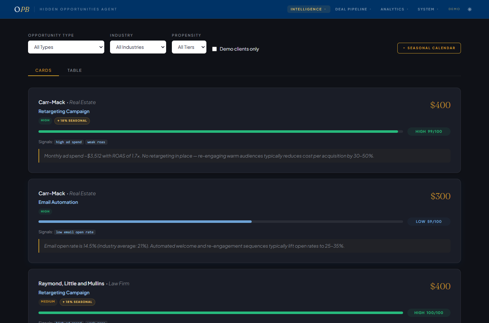

# Knowledge Learned

Lessons from auditing, testing and running Hidden Opportunities Agent. Each says what happened and the
rule that now follows. Open problems are at the end.

---

## 1. Failures that hide

**1.1 A swallowed exception looks like success.** Production follow-ups called the email sender with
arguments it did not accept. The error was caught, printed and the entry marked `sent`. No follow-up
could ever have been delivered.
*Rule:* record success only after the action returns. A failed send stays pending.

**1.2 A passing suite can miss a whole mode.** All tests passed while every production-only path was
untested.
*Rule:* test non-demo paths with fake providers; never rely on demo mode alone.

**1.3 A log line broke a request.** On Windows with redirected output, printing `Δ` raised an encoding
error after the database had been updated: the client saw a failure for an action that happened.
*Rule:* logging must not be able to fail the request.

## 2. Business logic

**2.1 Substring matching reverses meaning.** "I can't accept" and "not ideal" (contains "deal") closed
negotiations as won.
*Rule:* word boundaries, negation checked first, and a wrong "won" counted as the worst error.

**2.2 A state without a record never ends.** The kill switch updated the proposal but wrote no
negotiation row, so the thread stayed active.
*Rule:* every terminal transition writes the evidence that readers use to detect it.

**2.3 "Rejected" for something still open creates duplicates.** A price objection marked the opportunity
rejected, so the next detection inserted a second one.
*Rule:* close an opportunity only when the conversation is over.

**2.4 Stopping rules matter as much as sending rules.** Only acceptance cancelled follow-ups; clients who
declined or complained kept receiving them.
*Rule:* list the replies that stop automation, and re-check status at send time.

**2.5 Two code paths, two answers.** Single-client scoring used the historical maximum of days inactive;
portfolio scoring used the latest value. They differed for 148 of 155 clients.
*Rule:* one definition per metric.

## 3. Data and performance

**3.1 `NULL` is not zero.** One missing metric raised a comparison error and took down the whole
opportunities list.
*Rule:* drop missing values and let each rule apply its default.

**3.2 Per-row work is the usual cost.** SHAP rebuilt its explainer for every row (53 s → 2.7 s when
batched); the proposals page made one request per card.
*Rule:* batch at the boundary, then measure.

**3.3 Placeholders are not empty.** `.env` copied from the example held `sk-...`, which was treated as a
real key and produced a failed API call per proposal.
*Rule:* validate configuration, not just presence.

## 4. Repository hygiene

**4.1 Ignored files can be load-bearing.** The labelled dataset matched an ignore rule and existed only
locally, so CI failed at test collection. That failure then hid about thirty more that needed a seeded
database.
*Rule:* run the suite from a clean checkout before trusting it.

**4.2 Dependencies need an owner.** `node_modules` was committed (2,502 files). `torch` and
`transformers` are installed on every CI run and imported nowhere.
*Rule:* every dependency has an import that justifies it.

## 5. Testing the interface

**5.1 Smoke tests are not eyes.** 24 interface tests and 91% line coverage passed while the Churn tab
showed no signal or date and dark mode had unreadable text. Screenshots found both.
*Rule:* look at the screens, and assert on what a user reads, not only that a page renders.

**5.2 Two endpoints with similar names, different fields.** The Churn tab read `churn_signal` and
`escalated_at` from `/churn/log`, which returns `signal` and `timestamp`. Untyped
`Record<string, unknown>` data let it compile.
*Rule:* type API responses; test that the values appear on screen.

**5.3 Measure contrast, do not eyeball it.** The screenshot showed two dark-mode problems. A script that
walked every page and tab found 33 text styles below 3 : 1, including chart numbers at 1 : 1.
*Rule:* one colour token per role. `--primary` is a background; navy text uses `--primary-text`.

## 6. Writing documentation

**6.1 Policy is not behaviour.** `GOVERNANCE.md` states limits that the code does not enforce, and
production notes in the code describe features (nightly retraining, cancellation window) that do not
exist.
*Rule:* document what runs; label intentions as intentions.

## 7. Open findings

Found while documenting. **None of these has been fixed.**

### 7.1 Governance gaps

| Policy | Code today |
|---|---|
| Discount without approval ≤ 15% | Third negotiation turn offers 20% |
| One contact per opportunity in 30 days | No limit enforced |
| Opt-out in every message, processed within 24 h | None (WhatsApp text says "reply STOP" but nothing handles it) |
| Pause after 3 rejections | Not implemented |
| Cancellation window before autonomous send | Not implemented |
| All sends need approval except tier C | Scheduled follow-ups send without approval |
| Client data anonymised before LLM calls | Client name and metrics are sent |
| Audit log with agent version and decision basis | Not recorded |
| (not in policy) API access control | No authentication |

### 7.2 Brand colours fall short on contrast

In both themes, gold, green and orange text on light surfaces, and white text on gold or orange buttons
and badges, measure about 2.4–3.0 : 1. WCAG AA asks for 4.5 : 1 for text of this size. This is a palette
decision.

### 7.3 The in-app rules table disagrees with the code

The Overview page describes conditions that `rules.py` does not use. For Landing Page Optimisation it
says bounce > 60% and conversion < 1.5%; the code requires CTR > 4%, bounce > 70% and fewer than 2 pages
per session. The code is what runs ([APPLIED_AI.md §2](APPLIED_AI.md#2-detection-rules)).

### 7.4 Smaller items

- Proposal emails are sent as plain text but contain Markdown (`**`, `~~`).
- One negotiation template mixes languages: "Would you like su account manager…".
- The ROI dashboard and Pilot report compute acceptance rate differently; "ROI" is a conversion ratio.
- The seasonal calendar lists Year-End Planning with ×1.00: no December multiplier exists for its types.
- Running detection again from the Alert Feed repeats alerts already sent.
- ML cross-validation includes augmented copies (see [APPLIED_AI.md §3](APPLIED_AI.md#3-acceptance-model)).
- Docker files still start the legacy Streamlit UI.
- Some `test_sprint2` alert tests do not redirect `LOGS_DIR`, so running the suite appends to the real
  `logs/alerts.jsonl`.
